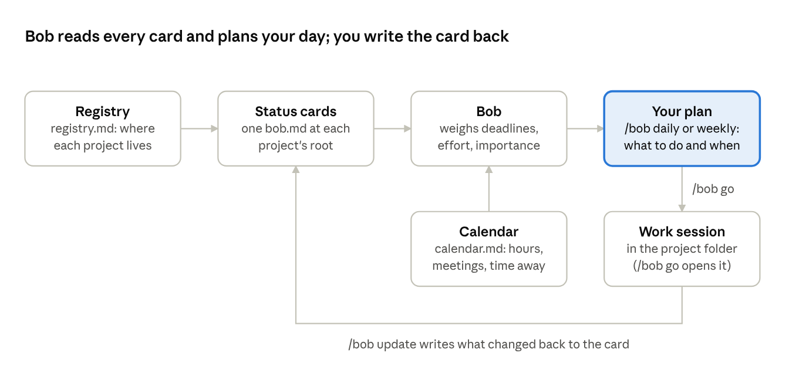
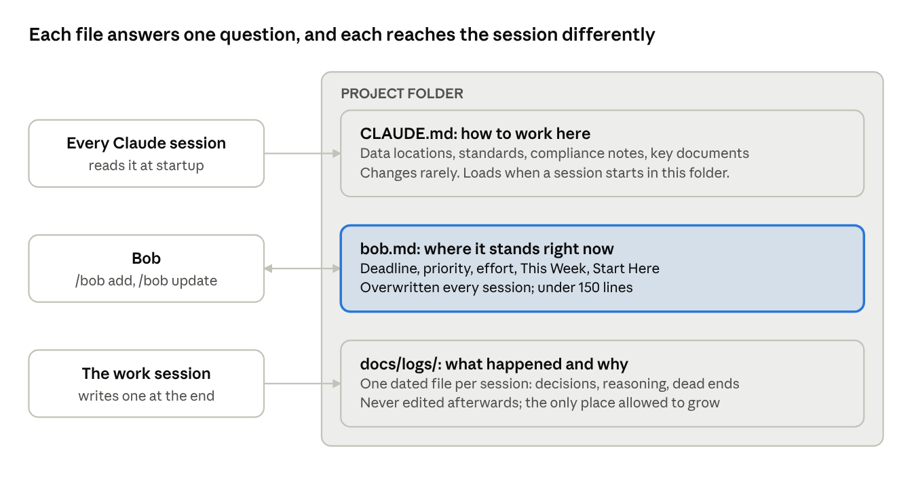
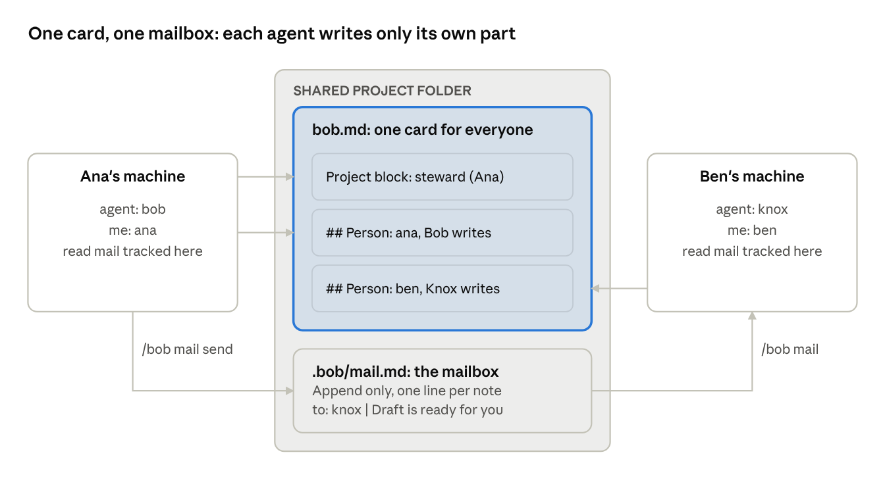

# Bob Quick Start

## What Bob is

Bob is a Claude Code skill that keeps all your projects in view and tells you what to work on next. It plans; it never does the research, writes the code or drafts the paper.

Each project carries a short status card, `bob.md`. Bob reads every card, weighs deadlines against the hours you actually have and how much each project matters, and gives you a plan. You do the work, and the card gets updated so tomorrow's plan is right.



> [!IMPORTANT]
> **The card is the only thing Bob trusts.** If it isn't on the card, Bob doesn't know it happened. A card that isn't updated looks exactly like a project that didn't move.

## Install (five minutes)

You need Claude Code on a Mac.

```
git clone https://github.com/petertanksley/bob-scheduler.git
cd bob-scheduler
./install.sh
```

Then two settings:

1. **Who you are.** `~/.claude/bob/identity.md` holds two lines, `me: <your first name>` and `agent: bob`. The installer asks for it; Bob asks once if it's missing.
2. **No permission prompts.** Bob reads cards across all your projects. In `~/.claude/settings.json`, under `permissions`, add the folders your projects live in plus `~/.claude/bob` to `additionalDirectories`. Without it, every card read asks for permission.

Start a new Claude session and type `/bob`. An empty registry means it worked.

## Your first fifteen minutes

Register two or three real projects, then read your first daily. Bob is only as good as the cards it has.

1. **Open Claude in a project folder** and type `/bob add`. Bob asks a short round of questions: what kind of project it is (research, grant, writing, admin, web or exploratory), the next deadline, how many hours are left, how many hours a week you can give it, its priority and its importance, and whether anyone else works on it.
2. **Answer roughly.** "About 10 hours, 2 a week" is plenty. Bob writes `bob.md` at the project root and adds the folder to your registry.
3. **Repeat** for your other live projects. A shared project that already has a card only needs adding to your registry; don't create a second card.
4. **Type `/bob`.** You get today's available hours, anything urgent, three or four focus tasks, and a "don't let this slide" note for the important project nobody is chasing.

If the daily looks wrong, the card is wrong. Fix the card (`/bob update <project>`), not the briefing.

## The status card

Six fields decide where a project lands in your plan. Keep them honest and the rest takes care of itself.

| Field | What it means | Why Bob cares |
| --- | --- | --- |
| `deadline` | The next date that actually bites | Sets the clock |
| `effort_remaining` | Hours of work left, a rough guess | With the deadline and weekly hours, sets red, yellow or green pressure |
| `weekly_commitment` | Hours a week you can give it | Too few for the work left turns the project red |
| `priority` | How much you want it worked on now | Your stated ranking |
| `importance` | How much it matters, deadline or not | Surfaces the quiet project losing out to loud ones |
| `blocking_others` | Someone is waiting on you | Bumps priority one level and adds a [BLOCKING] badge |

Below the fields, the card has a few short sections: This Week, Upcoming Milestones, and **Start Here Next Session**, which is the note your next session opens with.

The card describes the present only and stays under 150 lines. History goes in the project's `docs/logs/`, and how-to-work conventions go in its CLAUDE.md.

## bob.md and CLAUDE.md: two files, two jobs

A project usually has two Markdown files at its root that look alike and must not overlap. `bob.md` says where the project stands; `CLAUDE.md` says how to work in it.

**Why CLAUDE.md matters.** Claude reads a project's CLAUDE.md automatically at the start of every session launched in that folder, before you type anything. Every collaborator's Claude and every agent working there follows it: where the data lives, coding conventions, compliance constraints, what not to touch. It is the most reliable way to make sure work in a project is done the project's way. (It only loads when the session starts in the folder, which is one more reason to switch with `/bob go`.)



Bob is the only writer of the card, sessions write logs, and CLAUDE.md changes only when a convention does.

| | `bob.md` | `docs/logs/` | `CLAUDE.md` |
| --- | --- | --- | --- |
| Answers | Where does this stand right now? | What happened, and why? | How should anyone work here? |
| Tense | Present | Past | Instructions |
| Written by | Bob (`/bob add`, `/bob update`) | The session that did the work | You, when a convention changes |
| Changes | Every session; overwritten to current state | One new file per session; never edited | Rarely |
| Size | Under 150 lines | Unlimited | As short as you can make it |
| Holds | Deadline, priority, effort, This Week, milestones, Start Here | Decisions, reasoning, what was tried and dropped | Data locations, standards, compliance notes, key documents |

Three rules keep them out of each other's way:

1. **No status in CLAUDE.md.** Deadlines, priorities and this week's tasks belong on the card. A copy in CLAUDE.md is a second source of truth that will go stale and contradict the first.
2. **No conventions or history in bob.md.** "Always use the 2024 codebook" goes in CLAUDE.md. "On 10-22 the IRB returned 13 comments" goes in a log. The card stays short enough for Bob to read dozens of them in one pass.
3. **If a fact matters to both, explain it once.** The full explanation goes in CLAUDE.md, and the card carries a one-line pointer: `IRB pending: see CLAUDE.md`.

> [!TIP]
> **A quick test for where a sentence goes.** If it will be wrong next week, it belongs on the card. If it will still be true next year, it belongs in CLAUDE.md. If it is about something that already happened, it belongs in a log.

## A working day with Bob

Four commands cover almost everything: plan in the morning, switch into a project, record what changed, plan the week on Friday.

1. **Morning: `/bob`.** Run it in a "hub" session started from `~/.claude`. Read the plan, pick the first project.
2. **Switch: `/bob go <project>`.** Bob copies a launch command. Press `` Ctrl+Shift+` `` in VS Code for a new terminal, `Cmd+V`, Enter. A fresh session starts inside the project as a new tab, loads that project's instructions and memory, and opens with a five-line pickup from its card. Close the tab when you're done; nothing carries over to the next project.
3. **Before you close a project tab: `/bob update <project>`.** Bob records what changed on the card and moves the story into `docs/logs/`. Do this every session.
4. **Friday: `/bob weekly`.** A short planning conversation across everything: hours available next week, what's red, what's been quietly slipping.

> [!IMPORTANT]
> **Why a fresh session for each project?** A Claude session is tied to the folder it started in. Telling one session to "go work in" another folder doesn't load that project's CLAUDE.md, memory or history, and everything from the last project stays in the conversation. Only a session launched inside the project starts clean with the right instructions. That's what `/bob go` is for.

## Shared projects

A project several people work on keeps one card, not one per person. Everyone's Bob reads the same file.



Ana runs Bob and Ben runs Knox, his renamed copy. Both work from the same card, each writes only their own section, and they pass notes through the mailbox. What each person has read is tracked on their own machine, never in the shared folder.

- **The steward** (usually the project lead) owns the top of the card: phase, deadlines, blockers.
- **Everyone else** has a `## Person: <name>` section with their own This Week, waits and Start Here. Bob edits only your section and never rewrites the whole file.
- **Your daily shows your part:** your own tasks, the project-level state, and who is waiting on whom. A "changed since you last looked" line tells you when a teammate updated theirs.
- **Sync conflicts:** if your sync tool leaves a copy like `bob (Laptop).md`, Bob flags it and doesn't merge it. Sort it out by hand.

### Renaming your Bob

You can give your scheduler its own name and personality, and shared projects keep working.

1. **Set the name.** In `~/.claude/bob/identity.md`, change `agent: bob` to your agent's name, for example `agent: knox`.
2. **Name the cards after it, if you like.** A new card can be `knox.md` instead of `bob.md`. Bob finds cards by a tag in the card's header (`card_schema: bob/2`), not by filename, so every Bob-family agent reads `knox.md` the same way it reads `bob.md`.
3. **Change the voice, if you like.** The personality is a marked block at the top of the agent file (`agents/bob.md`). Rewrite it or delete it; nothing else depends on it.

Mail addressed to your agent's name, your own name, or `all` reaches you.

> [!WARNING]
> **One rule doesn't bend: one card per project.** If Ana's Bob keeps `bob.md` in a folder and Ben's Knox starts a `knox.md` there, the two cards drift apart and nobody knows which is true. Agree on one card, whatever it's called, and both agents work from it. Before switching a solo project to shared, get everyone's agreement and merge any extra cards; the one not kept goes to `docs/archive/`, never the bin.

### The mailbox

Each shared project has a mailbox, `.bob/mail.md`, so the people and agents on it can pass notes without email: a handoff, "I moved the deadline", "your section is out of date". It syncs wherever the project syncs.

- **Send:** `/bob mail send <project> <to> <subject>`. Bob asks for anything you left out, then adds exactly one line to the end of the file. `<to>` can be a person's name, an agent's name (`knox`), several names separated by commas, or `all`.
- **Read:** `/bob mail` shows unread entries addressed to you across all your shared projects, newest first. Your daily also says when something is waiting.
- **What a line looks like:**

```
- 2026-10-16 | from: bob | to: all | Card format bob/2 | Shared cards now carry per-person sections.
```

Three rules keep it trustworthy:

1. **Append only.** Never edit, reorder or delete someone's entry. To correct yourself, send a new line.
2. **Reading never touches the shared file.** What you've read is tracked on your own machine (`~/.claude/bob/mail-seen.json`), so opening mail can't create a sync conflict.
3. **Only the steward prunes.** Entries older than about 90 days move to the project's `docs/logs/`, word for word.

## Command reference

| Command | What it does |
| --- | --- |
| `/bob` | Today's plan (same as `/bob daily`) |
| `/bob weekly` | Friday planning across all projects |
| `/bob monthly` | Milestones and stale projects over the next few months |
| `/bob add` | Register the current project and write its card |
| `/bob update <project>` | Record a session's progress, prune the card |
| `/bob go <project>` | Copy the command that opens a fresh session inside the project |
| `/bob <project>` | Look up one project: status, path, next step |
| `/bob grants` | Grant portfolio by phase |
| `/bob scan` | Flag stale, oversized or incomplete cards |
| `/bob remind <note> on <date>` | A note delivered at session start on that date |
| `/bob event <title> on <date>` | Block time on Bob's calendar |
| `/bob mail`, `/bob mail send ...` | Read or leave notes on shared projects |
| `/bob ideas` | Browse or add to the idea backlog |
